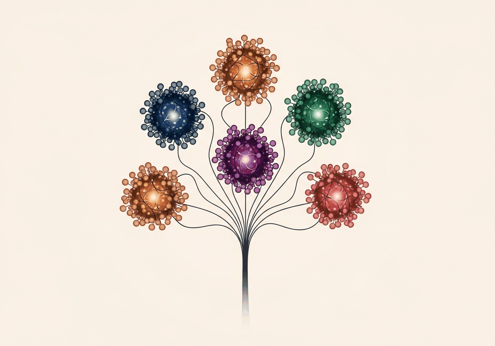
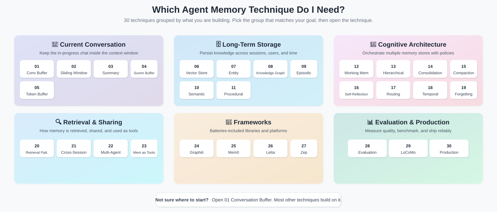
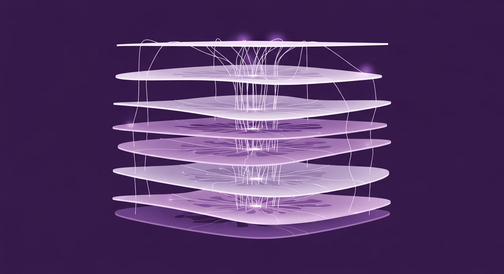
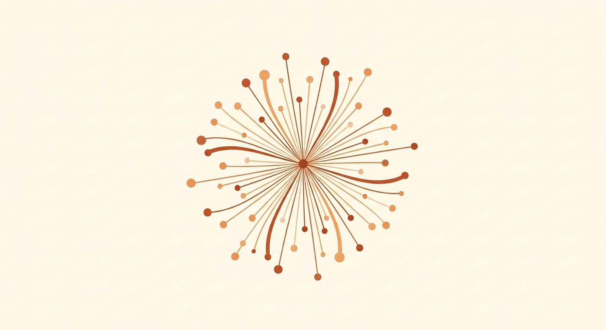
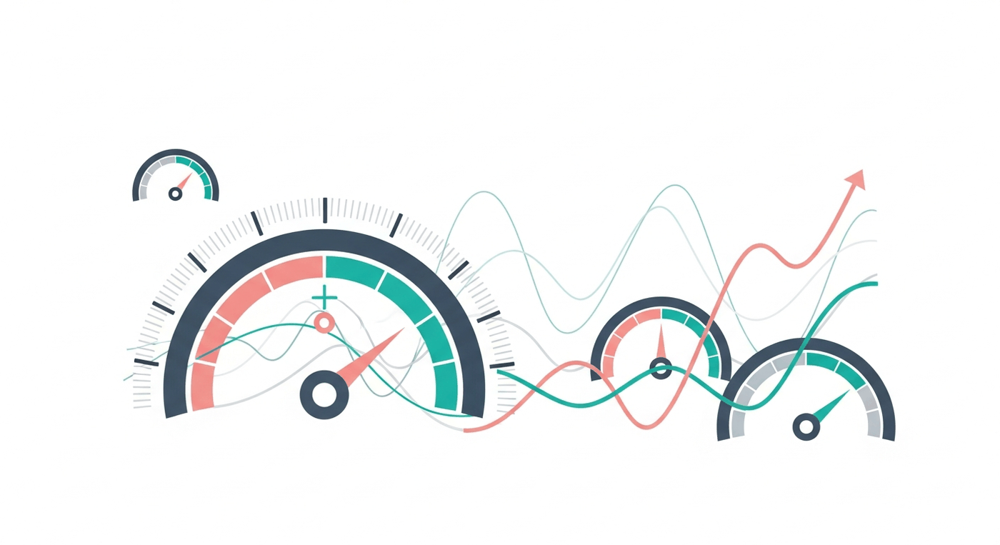

> 🧭  **初次到访？** 从 [01 对话缓冲区记忆](all_techniques/01_conversation_buffer_memory/) 开始，或者选择一条 [学习路径](#-学习路径)。更喜欢可视化？请看下方的 [决策树](#-我需要哪种技术)。30 个可运行的 Jupyter Notebook，覆盖对话缓冲区、向量存储、知识图谱、情景记忆与语义记忆、工作记忆、MemGPT、Mem0、Letta、Zep、Graphiti、LoCoMo 基准以及生产环境记忆模式。

本仓库的全部内容：30 种技术、184 幅定制插图、无需写代码。

---

## 💡 为什么 Agent 记忆很重要
> ### 💡 快速回答（面向搜索引擎和快速浏览者）
>
> **Agent 记忆**是一组技术，让基于 LLM 的智能体（围绕大语言模型构建的系统）能够在多轮对话、跨会话和跨任务中记住信息。没有记忆，智能体每次都要重新推导上下文，无法个性化、无法学习，也无法在长交互中保持连贯。本仓库记录了 30 种不同的记忆技术，分为六大类：短期上下文管理、长期存储、认知架构、检索与多智能体模式、开箱即用的框架，以及生产部署模式。

想象一个朋友，他忘记你们之间的每一次对话。每天早上你们又变回陌生人。今天大多数 AI 智能体就是这样。

每个 AI 智能体最终都会撞上同一堵墙：**它会忘**。

到了 2026 年，AI 智能体无处不在。但大多数仍然会忘记你昨天告诉它的事。没有强大的记忆，智能体无法在对话之间保持上下文，无法从过去的聊天中学习，也无法与你建立持久的关系。

格局正在快速变化：

- **Anthropic 的 7 层记忆**（2026 年 3 月）：从对话上下文到跨项目知识，为 Claude Code 定义记忆层级
- **Mem0**：托管记忆层，正被快速采用用于个性化 AI
- **Letta（MemGPT）**：具备内外独白架构的自编辑记忆
- **Zep**：面向长期 Agent 记忆的时间知识图谱
- **Graphiti**：从情景记忆到语义记忆的知识图谱抽取
- **MemOS 与 Memori**：面向生产级智能体的"记忆即基础设施"平台

但市面上没有一本统一的实操指南，教你**每种技术如何工作、何时使用、以及如何自己构建**。

这就是本仓库存在的意义。**30 种技术。可运行的 Notebook。今天就能用的真实代码。**

---

## 🗺️ Agent 记忆技术分类

<p align="center">
  
</p>

30 种技术分为六大类。每一类解决不同的记忆问题。每种技术都有自己的 Notebook。

| 类别 | 解决的问题 | 技术编号 |
|---|---|---|
| **短期记忆** | 在不让上下文窗口爆掉的前提下保留最近的对话轮次。 | 01 - 05 |
| **长期记忆** | 跨会话、跨用户、跨时间保存知识。 | 06 - 11 |
| **认知架构** | 工作记忆、分层记忆和反思型记忆系统。 | 12 - 19 |
| **检索与路由** | 决定何时回忆什么。 | 20 - 23 |
| **框架** | 生产级记忆库（Mem0、Letta、Zep、Graphiti）。 | 24 - 27 |
| **评估与生产** | 度量、基准测试和部署记忆。 | 28 - 30 |

---

## 🧭 我需要哪种技术？

按你要构建的东西把 30 种技术分组。先选与你目标匹配的组，再打开组内的具体技术。

<p align="center">
  
</p>

<!-- decision-tree-text-fallback -->
**快速文字版：**

- 需要管理当前聊天？从 **01-05**（短期记忆）开始。
- 需要跨会话持久化？从 **06 向量存储** 或 **21 跨会话记忆** 开始。
- 要构建包含多个存储的认知架构？见 **12-19**。
- 使用框架？直接看 **24 Graphiti**、**25 Mem0**、**26 Letta** 或 **27 Zep**。
- 要做评估或上线生产？见 **28-30**。

**还不确定？** 从 [01 对话缓冲区](all_techniques/01_conversation_buffer_memory/) 开始。几乎其他所有技术都建立在它之上。

---

## 📐 一眼对比各项技术

想按约束条件筛选（持久化、检索方式、token 成本、最适合的场景）？见 [并排对比矩阵](docs/comparison.md)，一张表覆盖全部 30 种技术。

---

## 📚 全部 30 种技术

<p align="center">
  
</p>

### 🔄 短期记忆（技术 1-5）

管理单次聊天内的对话。

| # | 技术 | 描述 | Notebook |
|---|-----------|-------------|----------|
| 01 | [对话缓冲区记忆](all_techniques/01_conversation_buffer_memory/) | 逐字保存完整对话。最简单的模式，也是一切的基础。 | ✅ [Notebook](all_techniques/01_conversation_buffer_memory/conversation_buffer_memory.ipynb) · [](https://colab.research.google.com/github/NirDiamant/Agent_Memory_Techniques/blob/main/all_techniques/01_conversation_buffer_memory/conversation_buffer_memory.ipynb) |
| 02 | [滑动窗口记忆](all_techniques/02_sliding_window_memory/) | 只保留最近几条消息。限制大小，但保留近期内容。 | ✅ [Notebook](all_techniques/02_sliding_window_memory/sliding_window_memory.ipynb) · [](https://colab.research.google.com/github/NirDiamant/Agent_Memory_Techniques/blob/main/all_techniques/02_sliding_window_memory/sliding_window_memory.ipynb) |
| 03 | [摘要记忆](all_techniques/03_summary_memory/) | 用模型写的简短摘要替换旧轮次。损失长度但保留含义。 | ✅ [Notebook](all_techniques/03_summary_memory/summary_memory.ipynb) · [](https://colab.research.google.com/github/NirDiamant/Agent_Memory_Techniques/blob/main/all_techniques/03_summary_memory/summary_memory.ipynb) |
| 04 | [摘要缓冲区记忆](all_techniques/04_summary_buffer_memory/) | 对较早轮次做摘要，但最近消息逐字保留。两者兼得。 | ✅ [Notebook](all_techniques/04_summary_buffer_memory/summary_buffer_memory.ipynb) · [](https://colab.research.google.com/github/NirDiamant/Agent_Memory_Techniques/blob/main/all_techniques/04_summary_buffer_memory/summary_buffer_memory.ipynb) |
| 05 | [Token 缓冲区记忆](all_techniques/05_token_buffer_memory/) | 将历史裁剪到严格的 token 预算内。优先丢弃最旧的消息。 | ✅ [Notebook](all_techniques/05_token_buffer_memory/token_buffer_memory.ipynb) · [](https://colab.research.google.com/github/NirDiamant/Agent_Memory_Techniques/blob/main/all_techniques/05_token_buffer_memory/token_buffer_memory.ipynb) |

<p align="center">
  
</p>

### 💾 长期记忆（技术 6-11）

跨会话、跨用户存活的存储。

| # | 技术 | 描述 | Notebook |
|---|-----------|-------------|----------|
| 06 | [向量存储记忆](all_techniques/06_vector_store_memory/) | 把过往消息转成向量（捕捉含义的数字列表）。之后按相似度搜索。 | ✅ [Notebook](all_techniques/06_vector_store_memory/vector_store_memory.ipynb) · [](https://colab.research.google.com/github/NirDiamant/Agent_Memory_Techniques/blob/main/all_techniques/06_vector_store_memory/vector_store_memory.ipynb) |
| 07 | [实体记忆](all_techniques/07_entity_memory/) | 抽取并跟踪关于人物、项目和偏好的事实。随对话增长而更新。 | ✅ [Notebook](all_techniques/07_entity_memory/entity_memory.ipynb) · [](https://colab.research.google.com/github/NirDiamant/Agent_Memory_Techniques/blob/main/all_techniques/07_entity_memory/entity_memory.ipynb) |
| 08 | [知识图谱记忆](all_techniques/08_knowledge_graph_memory/) | 构建实体之间如何连接的图。沿图行走，对智能体学到的东西进行推理。 | ✅ [Notebook](all_techniques/08_knowledge_graph_memory/knowledge_graph_memory.ipynb) · [](https://colab.research.google.com/github/NirDiamant/Agent_Memory_Techniques/blob/main/all_techniques/08_knowledge_graph_memory/knowledge_graph_memory.ipynb) |
| 09 | [情景记忆](all_techniques/09_episodic_memory/) | 存储完整交互，附带何时何地的上下文。适合回答"何时发生了什么"的问题。 | ✅ [Notebook](all_techniques/09_episodic_memory/episodic_memory.ipynb) · [](https://colab.research.google.com/github/NirDiamant/Agent_Memory_Techniques/blob/main/all_techniques/09_episodic_memory/episodic_memory.ipynb) |
| 10 | [语义记忆](all_techniques/10_semantic_memory/) | 从交互中抽取通用事实。独立存储，与原始情景分离。 | ✅ [Notebook](all_techniques/10_semantic_memory/semantic_memory.ipynb) · [](https://colab.research.google.com/github/NirDiamant/Agent_Memory_Techniques/blob/main/all_techniques/10_semantic_memory/semantic_memory.ipynb) |
| 11 | [程序记忆](all_techniques/11_procedural_memory/) | 捕捉"如何做"的知识：智能体随时间掌握的过程和工作流。 | ✅ [Notebook](all_techniques/11_procedural_memory/procedural_memory.ipynb) · [](https://colab.research.google.com/github/NirDiamant/Agent_Memory_Techniques/blob/main/all_techniques/11_procedural_memory/procedural_memory.ipynb) |

<p align="center">
  
</p>

### 🧩 认知架构（技术 12-19）

借鉴人类记忆方式的模式。

| # | 技术 | 描述 | Notebook |
|---|-----------|-------------|----------|
| 12 | [工作记忆与上下文窗口](all_techniques/12_working_memory_context_window/) | 管理智能体有限的注意力。动态地排优先级、钉住和驱逐上下文。 | ✅ [Notebook](all_techniques/12_working_memory_context_window/working_memory_context_window.ipynb) · [](https://colab.research.google.com/github/NirDiamant/Agent_Memory_Techniques/blob/main/all_techniques/12_working_memory_context_window/working_memory_context_window.ipynb) |
| 13 | [分层记忆层](all_techniques/13_hierarchical_memory_layers/) | 热、温、冷三层存储。随条目老化进行提升和降级。 | ✅ [Notebook](all_techniques/13_hierarchical_memory_layers/hierarchical_memory_layers.ipynb) · [](https://colab.research.google.com/github/NirDiamant/Agent_Memory_Techniques/blob/main/all_techniques/13_hierarchical_memory_layers/hierarchical_memory_layers.ipynb) |
| 14 | [记忆巩固](all_techniques/14_memory_consolidation/) | 合并、去重并强化记忆。灵感来自大脑在睡眠中的巩固过程。 | ✅ [Notebook](all_techniques/14_memory_consolidation/memory_consolidation.ipynb) · [](https://colab.research.google.com/github/NirDiamant/Agent_Memory_Techniques/blob/main/all_techniques/14_memory_consolidation/memory_consolidation.ipynb) |
| 15 | [记忆压缩](all_techniques/15_memory_compaction/) | 用摘要、实体抽取或蒸馏压缩已存记忆。节省存储和 token。 | ✅ [Notebook](all_techniques/15_memory_compaction/memory_compaction.ipynb) · [](https://colab.research.google.com/github/NirDiamant/Agent_Memory_Techniques/blob/main/all_techniques/15_memory_compaction/memory_compaction.ipynb) |
| 16 | [自我反思记忆](all_techniques/16_self_reflection_memory/) | 智能体回顾自己的行为。记录什么有效，下次使用。 | ✅ [Notebook](all_techniques/16_self_reflection_memory/self_reflection_memory.ipynb) · [](https://colab.research.google.com/github/NirDiamant/Agent_Memory_Techniques/blob/main/all_techniques/16_self_reflection_memory/self_reflection_memory.ipynb) |
| 17 | [记忆路由](all_techniques/17_memory_routing/) | 选择正确的记忆存储来读或写。按内容类型和意图路由。 | ✅ [Notebook](all_techniques/17_memory_routing/memory_routing.ipynb) · [](https://colab.research.google.com/github/NirDiamant/Agent_Memory_Techniques/blob/main/all_techniques/17_memory_routing/memory_routing.ipynb) |
| 18 | [时间记忆](all_techniques/18_temporal_memory/) | 给记忆附加时间戳。具备时间感知地检索，并对近期条目加权。 | ✅ [Notebook](all_techniques/18_temporal_memory/temporal_memory.ipynb) · [](https://colab.research.google.com/github/NirDiamant/Agent_Memory_Techniques/blob/main/all_techniques/18_temporal_memory/temporal_memory.ipynb) |
| 19 | [遗忘与衰减](all_techniques/19_forgetting_and_decay/) | 有目的地遗忘。利用衰减、访问计数或相关性进行剪枝。 | ✅ [Notebook](all_techniques/19_forgetting_and_decay/forgetting_and_decay.ipynb) · [](https://colab.research.google.com/github/NirDiamant/Agent_Memory_Techniques/blob/main/all_techniques/19_forgetting_and_decay/forgetting_and_decay.ipynb) |

<p align="center">
  
</p>

### 🔍 检索与多智能体（技术 20-23）

智能体如何找到并共享记忆。

| # | 技术 | 描述 | Notebook |
|---|-----------|-------------|----------|
| 20 | [记忆检索模式](all_techniques/20_memory_retrieval_patterns/) | 对比检索策略：语义搜索、时效性、混合评分、多样性和重排序。 | ✅ [Notebook](all_techniques/20_memory_retrieval_patterns/memory_retrieval_patterns.ipynb) · [](https://colab.research.google.com/github/NirDiamant/Agent_Memory_Techniques/blob/main/all_techniques/20_memory_retrieval_patterns/memory_retrieval_patterns.ipynb) |
| 21 | [跨会话记忆](all_techniques/21_cross_session_memory/) | 跨会话保存并重新加载智能体状态。用户从上次离开的地方继续。 | ✅ [Notebook](all_techniques/21_cross_session_memory/cross_session_memory.ipynb) · [](https://colab.research.google.com/github/NirDiamant/Agent_Memory_Techniques/blob/main/all_techniques/21_cross_session_memory/cross_session_memory.ipynb) |
| 22 | [多智能体共享记忆](all_techniques/22_multi_agent_shared_memory/) | 面向多智能体团队的共享存储、消息传递和一致性协议。 | ✅ [Notebook](all_techniques/22_multi_agent_shared_memory/multi_agent_shared_memory.ipynb) · [](https://colab.research.google.com/github/NirDiamant/Agent_Memory_Techniques/blob/main/all_techniques/22_multi_agent_shared_memory/multi_agent_shared_memory.ipynb) |
| 23 | [记忆即工具](all_techniques/23_memory_with_tools/) | 给智能体可调用的记忆工具：保存、搜索、遗忘。像其他工具一样对待。 | ✅ [Notebook](all_techniques/23_memory_with_tools/memory_with_tools.ipynb) · [](https://colab.research.google.com/github/NirDiamant/Agent_Memory_Techniques/blob/main/all_techniques/23_memory_with_tools/memory_with_tools.ipynb) |

<p align="center">
  
</p>

### 🔧 框架与平台（技术 24-27）

动手使用领先的记忆框架。

| # | 技术 | 描述 | Notebook |
|---|-----------|-------------|----------|
| 24 | [使用 Graphiti 的图记忆](all_techniques/24_graph_memory_graphiti/) | 使用 Zep 的 Graphiti 从聊天构建具备时间感知的知识图谱。抽取情景和通用事实。 | ✅ [Notebook](all_techniques/24_graph_memory_graphiti/graph_memory_graphiti.ipynb) · [](https://colab.research.google.com/github/NirDiamant/Agent_Memory_Techniques/blob/main/all_techniques/24_graph_memory_graphiti/graph_memory_graphiti.ipynb) |
| 25 | [Mem0 模式](all_techniques/25_mem0_patterns/) | 使用 Mem0 的托管记忆层。它负责抽取、存储和获取用户特定的记忆。 | ✅ [Notebook](all_techniques/25_mem0_patterns/mem0_patterns.ipynb) · [](https://colab.research.google.com/github/NirDiamant/Agent_Memory_Techniques/blob/main/all_techniques/25_mem0_patterns/mem0_patterns.ipynb) |
| 26 | [Letta（MemGPT）模式](all_techniques/26_letta_memgpt_patterns/) | 构建 MemGPT 的自编辑记忆。涵盖内心独白、心跳事件和记忆压力。 | ✅ [Notebook](all_techniques/26_letta_memgpt_patterns/letta_memgpt_patterns.ipynb) · [](https://colab.research.google.com/github/NirDiamant/Agent_Memory_Techniques/blob/main/all_techniques/26_letta_memgpt_patterns/letta_memgpt_patterns.ipynb) |
| 27 | [Zep 记忆](all_techniques/27_zep_memory/) | 使用 Zep 进行对话分类、实体抽取和时间感知图谱。为生产而生。 | ✅ [Notebook](all_techniques/27_zep_memory/zep_memory.ipynb) · [](https://colab.research.google.com/github/NirDiamant/Agent_Memory_Techniques/blob/main/all_techniques/27_zep_memory/zep_memory.ipynb) |

<p align="center">
  
</p>

### 📊 评估与生产（技术 28-30）

度量你的记忆，然后发布它。

| # | 技术 | 描述 | Notebook |
|---|-----------|-------------|----------|
| 28 | [记忆评估](all_techniques/28_memory_evaluation/) | 度量记忆质量。检查检索精确率和召回率、陈旧度、矛盾以及用户满意度。 | ✅ [Notebook](all_techniques/28_memory_evaluation/memory_evaluation.ipynb) · [](https://colab.research.google.com/github/NirDiamant/Agent_Memory_Techniques/blob/main/all_techniques/28_memory_evaluation/memory_evaluation.ipynb) |
| 29 | [记忆基准（LoCoMo）](all_techniques/29_memory_benchmarks_LoCoMo/) | 用 LoCoMo 和 LongMemEval 基准测试你的记忆。看它在长对话中的表现。 | ✅ [Notebook](all_techniques/29_memory_benchmarks_LoCoMo/memory_benchmarks_locomo.ipynb) · [](https://colab.research.google.com/github/NirDiamant/Agent_Memory_Techniques/blob/main/all_techniques/29_memory_benchmarks_LoCoMo/memory_benchmarks_locomo.ipynb) |
| 30 | [生产环境记忆模式](all_techniques/30_production_memory_patterns/) | 大规模运行记忆。缓存、TTL（生存时间）、分片、备份、GDPR 和可观测性。 | ✅ [Notebook](all_techniques/30_production_memory_patterns/production_memory_patterns.ipynb) · [](https://colab.research.google.com/github/NirDiamant/Agent_Memory_Techniques/blob/main/all_techniques/30_production_memory_patterns/production_memory_patterns.ipynb) |

---

## 🎯 学习路径

### 入门：基础

刚接触 Agent 记忆？从这里开始。这些是构建块。

```
01 对话缓冲区 → 02 滑动窗口 → 03 摘要记忆 →
05 Token 缓冲区 → 06 向量存储记忆 → 21 跨会话记忆
```

### 进阶：结构化记忆

准备好了吗？加入实体、图谱和更智能的检索。

```
07 实体记忆 → 08 知识图谱 → 09 情景记忆 →
10 语义记忆 → 20 检索模式 → 22 多智能体共享记忆
```

### 高级：认知架构

为高级智能体构建类人记忆模式。

```
12 工作记忆 → 13 分层 → 14 巩固 →
16 自我反思 → 17 记忆路由 → 19 遗忘与衰减
```

### 实践者：框架与生产

连接生产工具，并度量你构建的东西。

```
25 Mem0 → 26 Letta/MemGPT → 24 Graphiti → 27 Zep →
28 评估 → 29 基准 → 30 生产模式
```

---

## 🚀 快速开始

> 💡  **不想安装任何东西？** 每个 Notebook 都能直接在 GitHub 上渲染。点击上表中的技术即可在浏览器中阅读。或使用 Colab 徽章在云端运行。

```bash
# 创建虚拟环境
python -m venv venv
source venv/bin/activate  # Windows 上：venv\Scripts\activate

# 安装依赖
pip install -r requirements.txt

# 配置 API 密钥
cp .env.example .env
# 编辑 .env，填入 OPENAI_API_KEY 和/或 ANTHROPIC_API_KEY

# 启动 Jupyter，从第一种技术开始
jupyter notebook all_techniques/01_conversation_buffer_memory/
```

---

## 📁 项目结构

```
Agent_Memory_Structure/
├── README.md                           # 你在这里
├── ROADMAP.md                          # 当前状态与下一步
├── LICENSE                             # Apache 2.0
├── CITATION.cff                        # 如何引用本工作
├── requirements.txt                    # Python 依赖
├── .env.example                        # API 密钥模板
├── llms.txt                            # 面向 LLM 的可发现性索引
│
├── all_techniques/                     # 30 个技术文件夹，每个含 Notebook + README
│   ├── 01_conversation_buffer_memory/
│   ├── 02_sliding_window_memory/
│   ├── ...
│   └── 30_production_memory_patterns/
│
├── docs/                               # 项目文档
│   ├── architecture.md                 # 记忆系统设计模式
│   ├── comparison.md                   # 全部 30 种技术的并排对比
│   ├── glossary.md                     # 关键术语与定义
│   ├── learning_path.md                # 详细学习路径指南
│   ├── topics.md                       # 关键词索引
│   ├── roadmap.md                      # 原始规划存档
│   ├── FAQ.md                          # 常见问题
│   └── CONTENT_STANDARDS.md            # 写作风格规范
│
├── .github/                            # GitHub 社区文件
│   ├── CONTRIBUTING.md                 # 如何贡献
│   ├── CODE_OF_CONDUCT.md              # 社区准则
│   ├── SECURITY.md                     # 安全策略
│   ├── FUNDING.yml                     # 赞助配置
│   ├── ISSUE_TEMPLATE/                 # Issue 模板
│   ├── pull_request_template.md        # PR 模板
│   └── workflows/                      # CI 工作流
│
├── utils/                              # 共享辅助函数与校验器
│   ├── helpers.py                      # 环境加载、LLM 客户端、余弦、token
│   ├── validate_cells.py               # Notebook 单元结构校验器
│   └── validate_style.py               # 文风校验器
│
├── tests/                              # pytest 冒烟测试
├── data/                               # 小型示例数据集
└── images/                             # 图表与视觉素材
```

